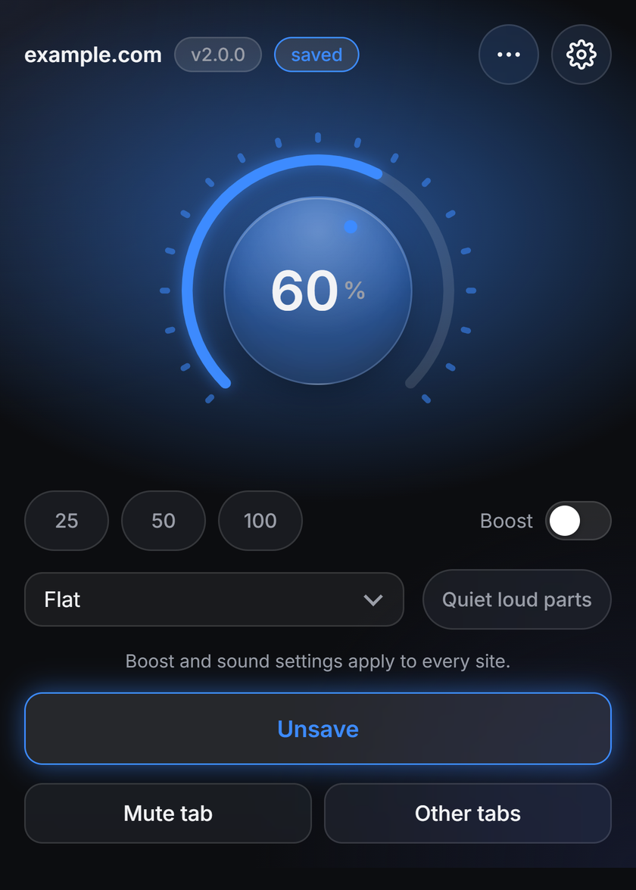
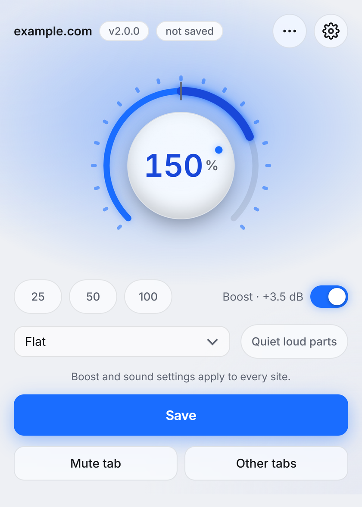
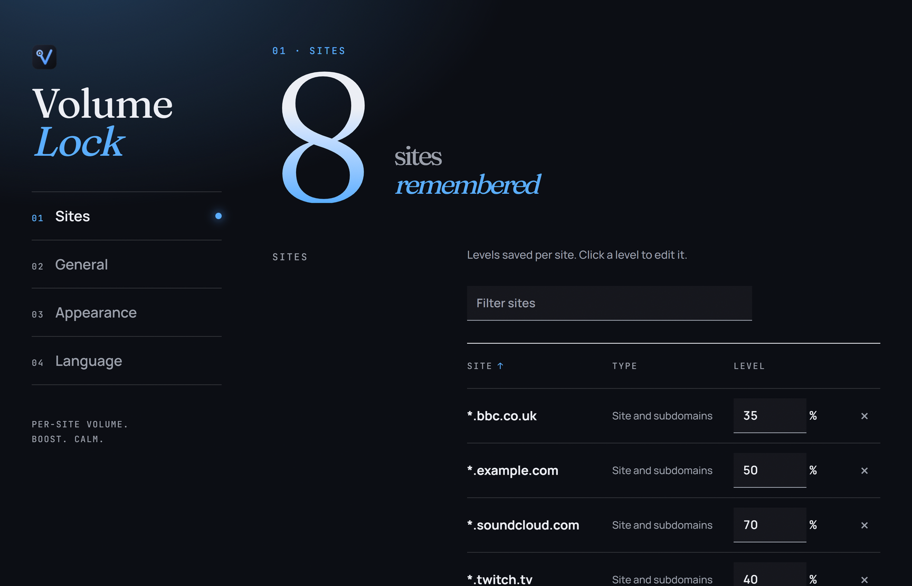

# Volume Lock

Chromium extension (Manifest V3, TypeScript) that remembers the volume of each site, with boost up to 600%, an equalizer and a night mode. Works in Chrome, Edge and Brave.

Chrome Web Store: [Volume Lock](https://chromewebstore.google.com/detail/volume-lock/hfpdohjhnfgkhnangkecmkhochllhifb). Edge and Brave: install from this GitHub repo (see Install).

<table>
  <tr>
    <td></td>
    <td></td>
    <td></td>
  </tr>
</table>

## Features

- **Per-site volume:** a rotary knob sets the level; Save stores it for the domain (or one URL) and it applies before media plays.
- **Boost:** up to 200, 300, 400 or 600%, with a limiter against clipping.
- **Sound:** five-band equalizer, night mode (leveler), mono and balance.
- **Autoplay:** block media that starts before any click or key press, per site.
- **Mute:** mute the current tab or all other audible tabs.
- **Shortcuts:** `Alt+Shift+Up/Down` volume, `Alt+Shift+M` mute, `Alt+Shift+S` save. Rebind at `chrome://extensions/shortcuts`.
- **Reset tab:** site menu item that ends tab capture and reloads the tab, restoring fullscreen and the page's own audio path.
- **Other tabs:** list of the other audible tabs with their own volume and mute.
- **Loud-level warning:** warns when the output level gets loud; quiet hours cap the level during a set time window.
- **Capture warning:** the popup says when a tab is boosted through tab capture.
- **Designs and languages:** 12 designs; English and Turkish.
- **Private:** no network requests; audio is analyzed in memory and never recorded.

## Install

Edge and Brave have no store listing. Get the source from GitHub (download the ZIP or clone), build it (Node 22 or later), then load `dist/`:

```bash
npm install
npm run build
npm run zip     # development/webstore/volume-lock-<version>.zip
```

Open `chrome://extensions`, `edge://extensions` or `brave://extensions`, turn on Developer mode, choose Load unpacked and select `dist/`. Rebind shortcuts on the `shortcuts` page of the same scheme.

## Limits

- Cross-origin media without CORS and DRM media are boosted through tab capture, which starts when the popup is opened on that tab. Use Reset tab if fullscreen breaks.
- Tabs open during install or update need a reload.
- Nothing works on browser-internal pages (`chrome://`, `edge://`, `brave://`) or the extension stores.
- The styled dropdown needs Chromium 135 or later; older versions show the native list.
- Saved sites sync through `chrome.storage.sync` (512 items, 100 KB).

## Layout

```
src/popup, src/options     popup and options page
src/ui                     knob, 12 designs, shared styles
src/lib                    settings, rules, storage, i18n
src/background.ts          tab capture, shortcuts, offscreen audio
src/content.ts, inject.ts  page-side audio graph
```

## License

Source-available, not open source. You can read, build, run and modify it for personal use, and fork it to propose changes. Uploading it (modified or not) to the Chrome Web Store or any other store, redistributing it as "Volume Lock", and commercial use are not allowed without permission. See [LICENSE.md](LICENSE.md).
