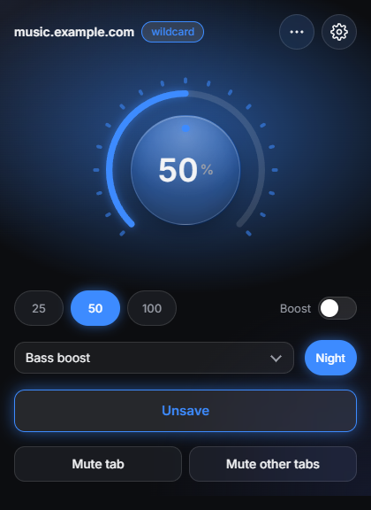
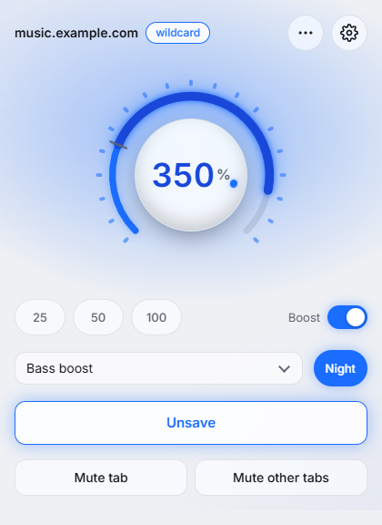
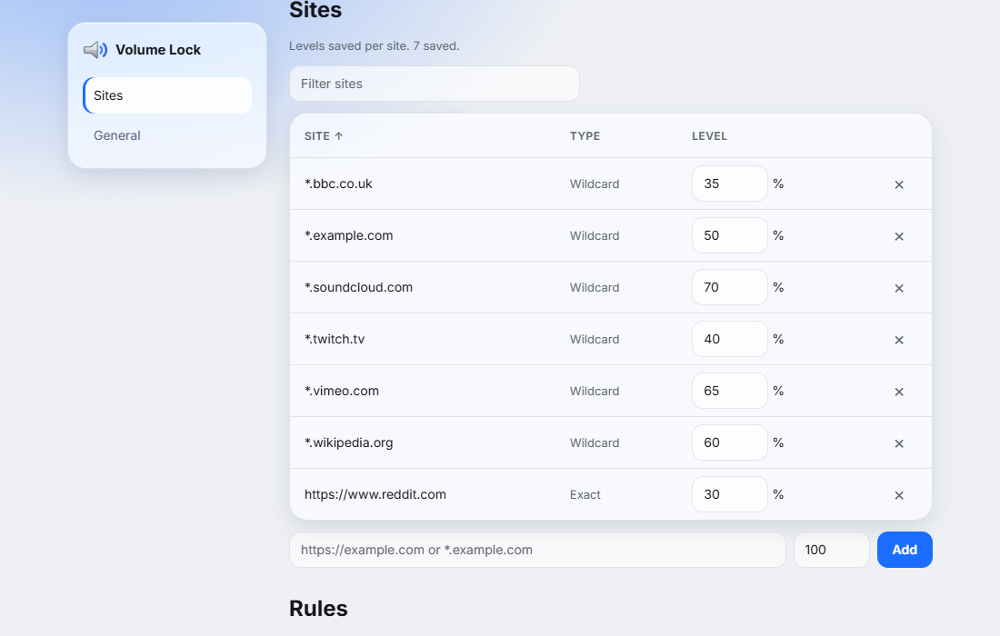

# Volume Lock

Chrome extension (Manifest V3, TypeScript) that remembers the volume of each site, with boost up to 600%, an equalizer and a night mode. Chrome only.

<table>
  <tr>
    <td></td>
    <td></td>
    <td></td>
  </tr>
</table>

## Features

- **Per-site volume:** a rotary knob sets the level; Save stores it for the domain (or one URL) and it applies before media plays.
- **Boost:** up to 200, 300, 400 or 600%, with a limiter against clipping.
- **Sound:** five-band equalizer, night mode (leveler), mono and balance.
- **Autoplay:** block media that starts before any click or key press, per site.
- **Mute:** mute the current tab or all other audible tabs.
- **Shortcuts:** `Alt+Shift+Up/Down` volume, `Alt+Shift+M` mute, `Alt+Shift+S` save. Rebind at `chrome://extensions/shortcuts`.
- **Reset tab:** site menu item that ends tab capture and reloads the tab, restoring fullscreen and the page's own audio path.
- **Private:** no network requests; audio is analyzed in memory and never recorded.

## Install

Build from source (Node 22 or later):

```bash
npm install
npm run build   # then load dist/ via chrome://extensions > Developer mode > Load unpacked
npm run zip     # webstore/volume-lock-<version>.zip
```

## Limits

- Cross-origin media without CORS and DRM media are boosted through tab capture, which starts when the popup is opened on that tab. Use Reset tab if fullscreen breaks.
- Tabs open during install or update need a reload.
- Nothing works on `chrome://` pages or the Chrome Web Store.
- Saved sites sync through `chrome.storage.sync` (512 items, 100 KB).

## License

MIT. See [LICENSE.md](LICENSE.md).
